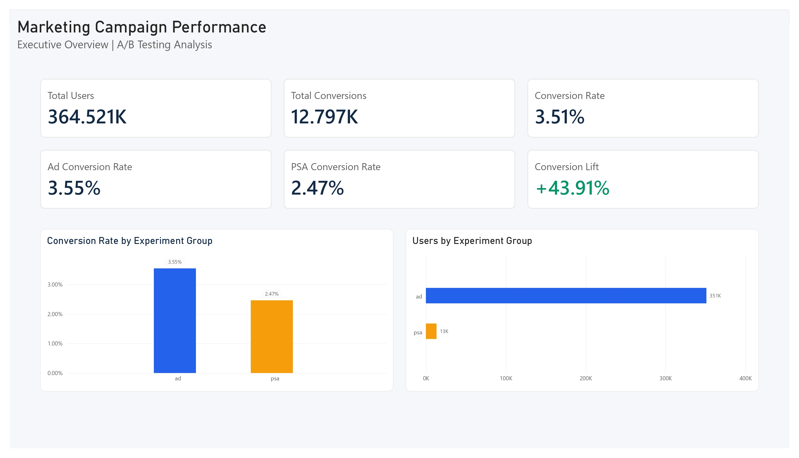
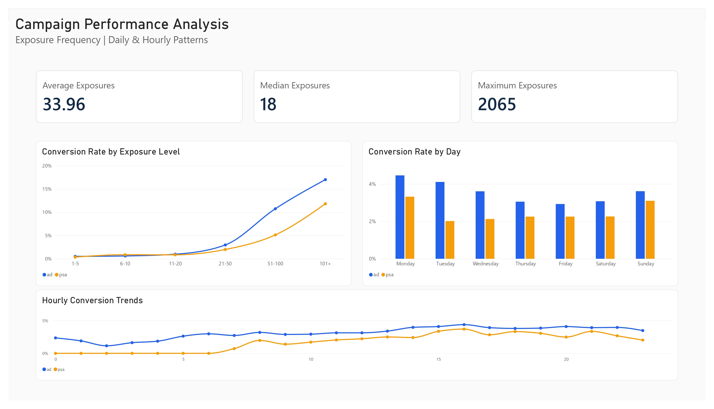
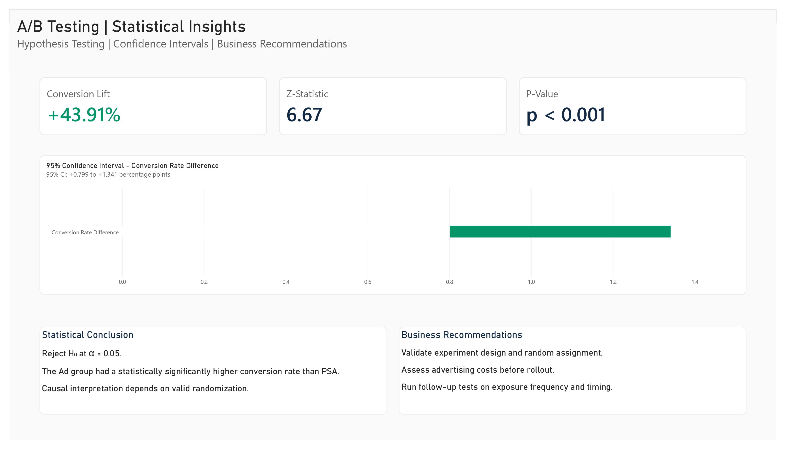

# Marketing Campaign Effectiveness | A/B Testing & Conversion Analysis

An end-to-end data analytics project using **Python, MySQL, statistical hypothesis testing, and Power BI** to evaluate conversion outcomes for a digital advertising experiment.

## Business problem

Did users assigned to the advertising group convert at a higher rate than users assigned to the public service announcement (PSA) control group? How large is the observed difference, and what can the business reasonably conclude from the experiment?

## Tools and methods

- **Python:** pandas, NumPy, Matplotlib, and statsmodels for data cleaning, exploratory data analysis, and statistical inference
- **MySQL 8:** data validation, conditional aggregation, common table expressions (CTEs), and `DENSE_RANK()` window functions
- **Power BI:** interactive three-page report with DAX KPIs, exposure analysis, and statistical-results summaries
- **Statistics:** two-sided two-proportion z-test and 95% Newcombe confidence interval for the absolute conversion-rate difference

## Dataset and preparation

**Dataset source:** [Marketing A/B Testing by faviovaz on Kaggle](https://www.kaggle.com/datasets/faviovaz/marketing-ab-testing). The source dataset was downloaded from Kaggle and cleaned for this project. Please refer to the dataset page for attribution and usage terms.

The analyzed dataset contains user-level assignment (`ad` or `psa`), purchase conversion (0/1), total exposure count, and the day/hour of greatest exposure.

- Original data: **364,522 rows**
- Removed **one incomplete record**
- Cleaned data: **364,521 unique users**
- Dropped an exported index column, standardized field names and types, and generated exposure groups (`1-5`, `6-10`, `11-20`, `21-50`, `51-100`, `101+`)

The notebook expects an input CSV named `marketing_AB.csv` in its working directory. The original data file is not included in this documentation bundle; provide the file before rerunning the notebook.

## Main findings

| Metric | Ad | PSA (control) |
|---|---:|---:|
| Users | 351,185 | 13,336 |
| Conversions | 12,468 | 329 |
| Conversion rate | 3.55% | 2.47% |

- **Absolute conversion-rate difference:** approximately **+1.08 percentage points** (Ad − PSA)
- **Relative conversion lift:** **+43.91%**
- **Two-proportion z-statistic:** **6.6714**
- **Two-sided p-value:** **< 0.001**
- **95% confidence interval for the absolute difference:** **+0.799 to +1.341 percentage points** (Newcombe method)

The results show strong statistical evidence of a difference between group conversion rates. A causal interpretation depends on the experiment's assignment and implementation being valid; these cannot be verified from the provided columns alone.

### Descriptive segment patterns

- In the **Ad** group, observed conversion increases from **0.51%** for users with 1–5 recorded exposures to **17.01%** for users with 101+ exposures.
- **Monday** has the highest observed conversion rate for both groups when grouped by day of highest exposure.
- **16:00** has the highest observed conversion rate for both groups when grouped by hour of highest exposure.
- Experiment group sizes are notably unbalanced (approximately **96.3% Ad / 3.7% PSA**).

These are **descriptive associations**, not causal evidence that increased frequency or particular scheduling hours will improve outcomes. The day and hour fields identify *peak exposure*, not the timestamp of a purchase.

## Power BI dashboard preview

The Power BI report (`dashboard/Marketing_Campaign_AB_Testing.pbix`) contains three pages. These screenshots show the report's full-page layout and visual analysis.

### 1. Executive Overview

Summarizes total users, conversions, overall and group conversion rates, relative conversion lift, and the size of each experiment group.



### 2. Campaign Performance

Explores exposure frequency and observed conversion-rate patterns across exposure groups, weekdays, and hours. These breakdowns are descriptive and do not establish causal effects of frequency or timing.



### 3. Statistical Insights

Presents the overall experiment's conversion lift, two-proportion z-test, p-value, 95% confidence interval for the absolute conversion-rate difference, and business recommendations.



## Recommendations and limitations

1. **Confirm experiment integrity:** verify random assignment, consistent outcome measurement, and any assignment or exposure biases before making a causal claim.
2. **Evaluate economic impact:** conversion lift alone does not demonstrate positive ROI; advertising cost, incremental revenue, and customer value are needed.
3. **Run targeted follow-up experiments:** test exposure frequency and delivery timing prospectively instead of treating observational breakdowns as optimal policy.
4. **Interpret segments cautiously:** some PSA hourly segments contain very few users, making their estimated conversion rates unstable.

## Project files

```text
Marketing-AB-Testing-Analysis/
├── README.md
├── notebooks/
│   └── Marketing_AB_Testing_Analysis.ipynb
├── sql/
│   └── marketing_ab_analysis.sql
├── dashboard/
│   ├── Marketing_Campaign_AB_Testing.pbix
│   └── screenshots/
│       ├── executive_overview.jpg
│       ├── campaign_performance.jpg
│       └── statistical_insights.jpg
└── data/                     # Add source / cleaned CSV only if redistribution is permitted
```

## Reproduction notes

1. Obtain the source CSV (`marketing_AB.csv`) and run the notebook cells in order with Python and the relevant packages installed.
2. Import the notebook's cleaned CSV export into a MySQL table named `marketing_ab_analysis.marketing_campaign` with the seven exported columns.
3. Run the SQL analysis script to reproduce data-validation and segmentation queries.
4. Open the `.pbix` report in Power BI Desktop. Its connection points to a MySQL instance used during development; update the data-source credentials and server if needed, then refresh.

**Note:** The original CSV and the database server are not packaged into the repository by default. Review data licensing and remove credentials or private connection details before publishing.
